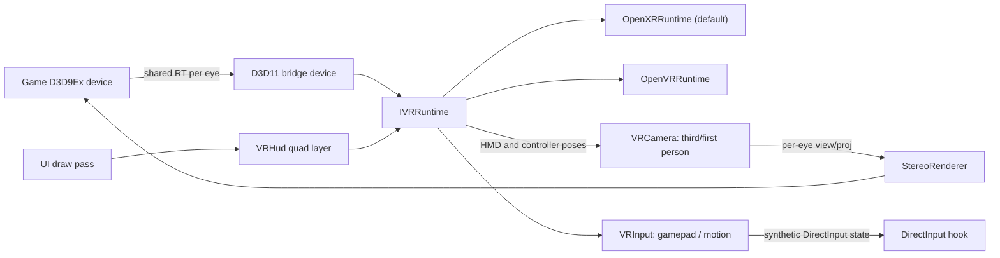

# PSUEx VR Add-on: Staged Roadmap

Goal: add a custom VR module (OpenXR, plus OpenVR as a second backend) to PSUEx for the Clementine Phantasy Star Universe client, in three stages:

1. Third-person stereo VR with a regular controller
2. First-person VR with a regular controller
3. First-person VR with motion controllers

Camera mode and input mode are independent settings, so every combination (third/first person x gamepad/motion) works at the end.

## Progress

- [x] Phase 0: Game folder noted (`D:\Games\PSUClementine_22072025`); static PE check of known addresses (`pe-match`); Ghidra project created
- [x] Phase 0: Ghidra anchors labeled (`ghidra-labeled`); load path documented (`dinput8` proxy — `di.dll` is not the PSUEx loader)
- [x] Phase 0: Runtime verify PSUEx loads / hooks fire on Clementine (`psuex.log`); check the server's mod rules
  - `dinput8` proxy loads `PSUExD.dll`; `PSU_InitializeDirect3D` + `g_pD3D` verified; plain Create9Ex+CreateDevice crashes — fixed via CreateDeviceEx when `vr.enabled`
- [x] Phase 0: `PSUVR` skeleton with OpenXR solid-color prototype + D3D9Ex upgrade behind `vr.enabled` (default off)
- [x] Phase 1: `PSUVR` module skeleton, `IVRRuntime`, OpenXR backend, D3D9Ex-to-D3D11 shared-surface bridge, frame loop driven from `Present`, `vr` config section
  - OpenVR backend still TODO. D3D9Ex requires `CreateDeviceEx` (plain `CreateDevice` on an Ex object crashes Clementine).
  - **D3D9Ex also rejects `D3DPOOL_MANAGED`.** Crash dumps all faulted at `d3d9.dll+0xF2A23` reading garbage — fixed by remapping managed creates to `DEFAULT|DYNAMIC` in `PSUVR/D3D9ExCompat` (validate with `vr.d3d9exOnly=true` before enabling OpenXR).
- [x] Phase 1: Virtual-screen path behind `vr.enabled` with `solidColorPrototype=false`
  - BB StretchRect → shared D3D9/D3D11 → **mono** `XrCompositionLayerQuad` (not dual-eye projection of the same BB — that looked like two characters).
- [x] Phase 1: Reverse engineer the scene render entry point
  - **`PSU_FrameRender` `0x00479F50`** → scene callback per mode (town = **`0x0046ACB0`**) → `if( byte[0x993328] ) { 0x004FD990(); 0x004FDBC0(); }` → 3 UI draws (`0x793C40`).
  - **`0x004FD990`** = 3D world pass (layers `0x02`–`0x29`, ~165 DIP, no UI). `0x004FDBC0` = 2D pass (DrawPrimitiveUP quads with its own PROJ).
  - Fixed-function: the game never sets VIEW (identity), the camera is baked into WORLD, and PROJ is set at `0x0074ADAA` before pass A.
  - Verified in town: `vr.debugEyeShift` sets VIEW to a sideways translation around pass A only. The 3D world shifts and the UI stays put.
- [ ] Phase 1: `StereoRenderer` (headset-tested). Pass A per eye into OpenXR-sized targets; head-locked projection submit; `vr.stereoSkipScreenQuads`; eye GPU fence. **Stereo only in scene mode `vr.stereoMode` (default 5 = town)** — login / mission / planet stay on a large head-locked virtual screen (`hudDistance` 2.5 m, height 1.4 m × `hudSize`). In town, `0x793C40` UI draws are replayed onto each eye RT as a HUD. `vr.stereoPanel` remains off by default.
- [ ] Phase 1 (original plan): run `0x004FD990` once per eye with VIEW = eye offset and PROJ = per-eye frustum, into left/right targets. Repeat-safety verified: running pass A twice per frame gives the same draws, its deferred lists refill within the pass, and animation speed is normal. Still open: depth/RT handling between eyes, and running the shadow-map part (`0x5E3630`/`0x5E37B0`) once per frame instead of per eye.
- [ ] Phase 1: `VRCamera` third-person mode (HMD on top of the orbit camera), `VRHud` UI quad layer, recenter and snap turn, `VRDisplay` ImGui panel
  - `VRDisplay` done (2026-10-15): in-game "VR Settings" window (also drawn into the HUD panel in the headset) and the standalone `PSUExVRConfig.exe`, both on the shared `PSUVR/VRSettings` + `PSUVR/VRSettingsPanel`. Runtime Pause VR, rebindable shortcuts (`PSUVR/VRBindings`: keys + Back+button pad chords) incl. on-the-fly first/third person.
- [ ] Phase 2: Player head position, first-person `VRCamera`, hidden head meshes, head-relative stick movement, usable lock-on
  - First cut (2026-10-14, awaiting headset test): `vr.cameraMode = "firstPerson"` steers the render camera (`*(*(task+0x24)+4)`, pos `+0xFC`, target `+0x108`) level behind the head (player `+0x114` + `fpEyeHeight`) along **body yaw**. The game's camera-relative movement is therefore body-relative (FPS / Skyrim style), and the HMD looks around freely in that frame (`VRCamera::BuildEyeFirstPerson`). The right stick is read through XInput (`PSUVR/VRGamepad`) for smooth turn (default, `fpTurnSpeed`) or snap turn. Without XInput, the game's orbit yaw change is the fallback. `fpMoveDirection` "head" (default) adds HMD yaw to the steer, while "body" keeps FPS-style movement.
  - Nameplates / bubbles / markers: pass-B draws whose stack holds `0x0056086D` (layer-object draw) and carry depth in z are re-projected into the eyes; our own plate (no depth, screen center) is skipped in first person. Head leashed to the body (`fpLeanLimit`, `fpCrouchLimit`).
  - Comfort rules: the world only moves from stick input and the head (1:1). First-person eyes are built from the camera the game actually renders (talk camera / smoothing cancelled, no double yaw); no head steering outside camera states 1/3 (5 = NPC talk); third person removes the orbit pitch (level horizon); snap turn default; optional peripheral vignette (`comfortVignette`).
  - HUD/menu panel is body-locked with lazy follow (`hudFollow`): LOCAL-space quad in front of the body (leash anchor in first person), re-centred when the head looks away past `hudFollowAngle`. Menus still close through the game itself.
  - Headless local player (`fpBody`, `PSUVR/VRPlayerDraw`): the local player's node in the draw layers (`0x00B9DB38`) gets a thunk around its draw callback. While it runs in a first-person eye pass, user clip plane 0 cuts everything above the neck (`fpNeckDrop`), so arms, hands, torso and legs stay. A WORLD-origin test hid nothing (characters are skinned on the CPU). Phase 3 hand override can hook into the same local-player draw window. `g_ViewMatrix` turned out to be init-only, so the camera is steered rather than replaced.
  - Still open: real head/hair hiding (eye offset only), culling pop at wide head angles (game frustum narrower than the HMD), follow-camera drift showing up as turn, lock-on and target markers.
- [ ] Phase 3: DirectInput hook that builds a synthetic gamepad from the motion controllers, with configurable bindings
- [ ] Phase 3: Gestures (swing, guard, point), laser pointer for the UI, weapon attached to the controller pose
- [ ] Verify all four combinations (third/first person x gamepad/motion) plus flat mode with VR off

## Where we start

PSUEx already gives us the hooks VR needs:
- D3D9 device and vtable hooks (`CreateDevice`, `EndScene`, `Present`, `SetTransform`, `SetRenderTarget`) in [PSUOverlay/PSUOverlay.cpp](../PSUOverlay/PSUOverlay.cpp). `Present` exists but is commented out.
- A camera update hook, plus the known view and projection matrix globals, in [PSUDetour/Hook_TCameraTaskPlay.hpp](../PSUDetour/Hook_TCameraTaskPlay.hpp):

```cpp
auto viewMatrix = PSUMemory::ReadAbsoluteMemory< Matrix4x4 >( 0x00A85C30 );
auto projectionMatrix = PSUMemory::ReadAbsoluteMemory< Matrix4x4 >( 0x00A85B30 );
```

- A disabled DirectInput hook stub in [PSUDetour/Hook_00774F90.hpp](../PSUDetour/Hook_00774F90.hpp), and a candidate UI draw function at `0x00793C40`.
- An ImGui overlay and a `config.json` system ([PSUExConfig.h](../PSUExConfig.h)).

Hard constraints:
- The game is a 32-bit DX9 process. OpenVR does not accept DX9 textures, so frames have to be passed through D3D11.
- Every hook uses fixed addresses for client 14.30, so we must confirm that the Clementine `PSUC.exe` (UPX-packed) matches.

## Architecture



New module `PSUVR/`:
- `VRRuntime.h`: the `IVRRuntime` interface, which covers init, the frame loop (wait/begin/end), eye poses and FOVs, controller poses and buttons, and swapchain submit.
- `OpenXRRuntime.cpp`: the default backend (OpenXR loader for x86, D3D11 graphics binding).
- `OpenVRRuntime.cpp`: a second backend for runtimes whose 32-bit OpenXR support is broken (OpenVR is reliable on x86).
- `D3D11Bridge.cpp`: upgrades the game to `Direct3DCreate9Ex`/`CreateDeviceEx`, creates the shared per-eye and HUD surfaces, and opens them in D3D11.
- `StereoRenderer.cpp`: draws the scene once per eye in the same game tick (synchronized sequential rendering, not alternating frames).
- `VRCamera.cpp`: builds per-eye view and projection matrices for each camera mode.
- `VRHud.cpp`: captures the 2D UI into its own render target and shows it as a floating quad layer.
- `VRInput.cpp`: hooks DirectInput device state and merges in gamepad passthrough, motion-controller mappings and gestures.
- `PSUOverlay/Interface/VRDisplay.*`: an ImGui settings panel, readable inside the headset through the HUD layer.

Settings go in a new `vr` section of `config.json`: `enabled`, `runtime` (openxr/openvr), `cameraMode` (thirdPerson/firstPerson), `inputMode` (gamepad/motion), `worldScale`, `ipdScale`, `hudDistance`, `hudSize`, `snapTurn`, `comfortVignette`. Camera mode and input mode are independent, so all four combinations are valid. With `enabled=false`, PSUEx behaves exactly as it does now.

## Local install

- Game folder: `D:\Games\PSUClementine_22072025`
- RE binary: `PSUC_Uncompressed.exe` (copy of `PSUC.exe`; this build is not UPX-packed)
- Toolchain root: `D:\PSUExTools` (Ghidra, x32dbg, UPX, uv cache)
- Ghidra project: `D:\PSUExTools\ghidra-projects\PSUClementine`
- Address map and RE notes: [ADDRESS_MAP.md](ADDRESS_MAP.md)

## Phase 0: Feasibility and Clementine compatibility
- Check that PSUEx loads into Clementine's client: unpack with `upx -d`, compare the hooked addresses (`0x00774AD0` WinMain, `0x00776590` D3D init, `0x0048DA90` camera, `0x00A85C30` view matrix), and find out how the DLL gets loaded (an import patch or a `dinput8` proxy, the same way psuseed does it).
- Check Clementine's rules on client-side mods.
- Prototype a 32-bit OpenXR session (SteamVR and Meta runtimes) and a 32-bit OpenVR session: a test DLL that clears the headset to a solid color.
- Prototype the D3D9Ex upgrade to confirm the game still runs. We support native DX9 only at first; dgVoodoo2 and DXVK setups are not targets yet.

## Phase 1: Third-person VR with a gamepad
1. Upgrade the device to D3D9Ex, set up the D3D11 bridge and backend init, and drive the VR frame loop from the `Present` hook.
2. Start with a stereo-less "virtual screen" pass: submit the back buffer as a quad layer to prove the frame pipeline end to end.
3. Reverse engineer the per-frame scene render entry point (the call between the camera update and the UI pass). Use the `SetRenderTarget` transition from the offscreen target to the back buffer, and the `0x00793C40` UI draw, to mark where the 3D scene ends.
4. `StereoRenderer`: run the 3D pass `0x004FD990` twice, with D3D VIEW set to the per-eye offset (the game leaves VIEW at identity) and PROJ overridden per eye (including asymmetric FOV projections from the runtime), writing into the left and right shared targets.
5. `VRCamera` third-person mode: keep the game's orbit camera position and apply HMD rotation and position on top of it. Add world-scale tuning and a recenter control.
6. `VRHud`: send the UI pass to its own target and show it as a quad roughly 2 m ahead. Move the minimap and chat into it.
7. Gamepad works unchanged (passthrough). Add a recenter binding and snap or smooth turn of the camera yaw.

## Phase 2: First-person VR with a gamepad
1. Find the player's world position and head bone or height through `m_playerDataPtr` in `CameraTaskPlayData`, and the game's existing first-person look state (`fpsViewSpeed`, `unknown_b`).
2. `VRCamera` first-person mode: place the eyes at the head position, let HMD yaw and pitch drive the view, and turn off the game's camera smoothing and collision pushback.
3. Hide the local player's head and hair meshes (skip their draws in the `DrawIndexedPrimitive` hook, or toggle model visibility), keeping the body optional.
4. Make movement follow the head or the stick: rotate the left stick vector by HMD yaw before the game reads it, and turn the player model to match the view.
5. Keep lock-on and targeting usable: lock-on or auto-target stays game-driven, and the HUD shows target markers.

## Phase 3: First-person VR with motion controllers
1. Install the `VRInput` DirectInput hook (re-enable and extend `sub_774F90`, then hook `GetDeviceState`/`GetDeviceData` on the created devices). Generate a synthetic gamepad state from the controllers.
2. Default action mapping: thumbsticks become the sticks, triggers and grips become attack, guard and Photon Arts, face buttons become menu and jump, and the bindings live in config.
3. Gestures: a swing faster than a speed threshold triggers a normal attack, a held cross-guard pose holds guard, and pointing at an enemy with a gun or technique sets the lock-on target.
4. A laser pointer for HUD and menus, mapped to the game's cursor or menu navigation.
5. Visual hands: attach the equipped weapon to the controller pose by overriding the hand and weapon bone transforms before skinning. Hit detection stays game-driven.
6. Make sure motion input also works in third-person mode, so all four camera and input combinations are covered.

## Cross-cutting
- Comfort: snap turn, a vignette during movement, adjustable height, and a world-scale slider.
- Performance: render the eyes sequentially in the same tick, and use runtime-recommended resolution times a scale setting. VR must target 72-90 fps, so we have to check the game's 30 or 60 fps tick and add motion smoothing or reprojection reliance.
- Dependencies, added to [PSUEx.vcxproj](../PSUEx.vcxproj): the OpenXR SDK (x86 loader), the OpenVR SDK (`win32` lib and dll), and the Windows SDK D3D11/DXGI headers.
- Safety: VR changes only rendering and local input. No packet changes, so the server-visible behaviour stays the same as normal play.

## Research notes
- No VR mod exists for Clementine yet. Its community mods cover UI skins, button prompts and English voices only ([Clementine Mods wiki](https://www.psu-clementine.com/wiki/Mods)).
- [psuseed](https://github.com/HybridEidolon/psuseed) is a `dinput8` wrapper for Clementine. It needs an uncompressed exe (`upx -d -o PSUC_Uncompressed.exe PSUC.exe`) for memory patches.
- UEVR only works with Unreal Engine games, so it can't be used here.
- OpenVR does not support DX9 textures ([openvr#52](https://github.com/ValveSoftware/openvr/issues/52)). D3D9Ex shared surfaces opened in D3D11 are the usual workaround ([Super-VRExport-Addon](https://github.com/BerZerker96/Super-VRExport-Addon)).
- Reference for adding VR to a flat game from the outside: [vrframework guides](https://github.com/elliotttate/vrframework).
- Newer Intel graphics have no native DX9, so those users run dgVoodoo2 or DXVK ([DgVoodoo2 Guide](https://psu-clementine.com/wiki/DgVoodoo2_Guide)). That setup is out of scope at first.
